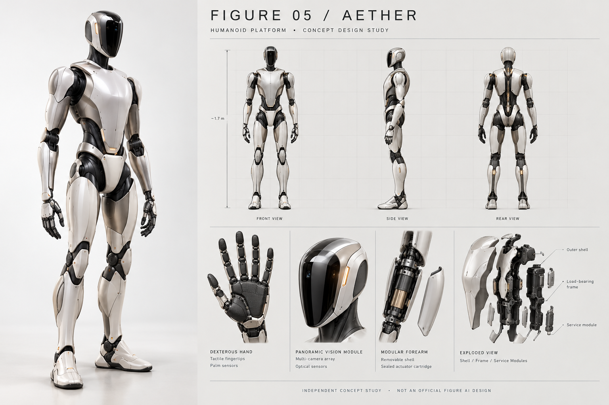

# AETHER — Independent Humanoid Robotics Concept Study

**AETHER** is an independent, speculative portfolio project exploring a possible future humanoid robotics platform, with an initial focus on a serviceable robotic hand-and-forearm subsystem.

> **Important disclaimer:** This is an independent concept study. It is **not** an official Figure AI project, is not endorsed by or affiliated with Figure AI, and does not describe or predict any unreleased Figure product. “Figure 05” is used only as a hypothetical framing for this portfolio exercise. All Figure names and marks belong to their respective owners.

## Project question

Could a humanoid hand-and-forearm module be designed to make fingertip wear, tactile-sensor replacement, and recalibration easier to service and objectively evaluate—without unacceptable trade-offs in dexterity, mass, backlash, or reliability?

The current design hypothesis is that replaceable fingertip/sensor modules, serviceable actuation or transmission subassemblies, and a documented calibration procedure may improve maintainability and fault isolation. This hypothesis has **not** been validated; the added interfaces could also introduce failure modes and must be compared with a baseline through controlled testing.

## What is in this repository?

- **Concept design:** concept renders, front/side/rear views, detail views, and an editable slide deck.
- **Engineering concept brief:** preliminary architecture, candidate requirements, risks, and a proposed verification plan.
- **Hand/forearm concept sheet:** an envelope-level schematic intended to communicate design intent.
- **Working notes:** open engineering questions, analysis tasks, draft test matrix, and evidence standards.
- **Application materials:** a draft outreach email and a candidate-profile checklist.
- **References:** public sources consulted for context.

### Start here

1. Read [`AETHER_Engineering_Concept_Brief.pdf`](AETHER_PORTFOLIO/02_Engineering/AETHER_Engineering_Concept_Brief.pdf).
2. View the [concept presentation (PDF)](AETHER_PORTFOLIO/01_Concept_Design/AETHER_Concept_Presentation.pdf) or edit the [PowerPoint deck](AETHER_PORTFOLIO/01_Concept_Design/AETHER_Concept_Presentation_EDITABLE.pptx).
3. Review the [hand-and-forearm concept sheet (PDF)](AETHER_PORTFOLIO/02_Engineering/AETHER_Hand_Forearm_Concept_Sheet.pdf).
4. Read the [engineering working notes](AETHER_PORTFOLIO/02_Engineering/AETHER_Engineering_Working_Notes.md) and [project status and claim boundaries](AETHER_PORTFOLIO/02_Engineering/PROJECT_STATUS_AND_CLAIM_BOUNDARIES.txt).
5. For Spanish-language context, see [`README_ES.md`](AETHER_PORTFOLIO/README_ES.md).

## Current status

**Stage:** early concept and portfolio documentation.

### Completed in this package

- Visual concept board and presentation.
- Preliminary hand-and-forearm architecture and envelope-level concept sheet.
- Initial design hypothesis, open requirements, risks, and proposed validation matrix.
- Draft outreach email and candidate checklist.

### Not completed

- Native parametric 3D CAD or a fully constrained assembly.
- Manufacturing-ready drawings, GD&T, tolerance analysis, or validated material selections.
- Dimensioned and sourced actuator, motor, gearbox, or sensor selection.
- Verified torque, speed, force, power, thermal, battery, or mass budgets.
- Completed simulations, physical prototype, bench tests, measured results, or certification.
- Patent, prior-art, or freedom-to-operate review.

The PDF concept sheet is **not a manufacturing drawing**. Rendered images are illustrative concept visuals, not verified CAD geometry. Some visuals were created with AI-assisted image-generation tools and may contain geometric details that are not mechanically consistent.

## Proposed next steps

1. Define a small set of grasping tasks and representative objects.
2. Specify the required force, range of motion, speed, duty cycle, and contact limits.
3. Develop a parametric CAD model and kinematic chain.
4. Evaluate collisions, loads, transmission options, service interfaces, and tolerance needs.
5. Select components from supplier data only after the requirements and calculations are defined.
6. Build a guarded bench demonstrator and run repeatable calibration, service-time, grasp-cycle, and thermal tests.
7. Publish measured results with methods, units, sample counts, hardware revisions, and limitations.

No proposed test should be represented as completed until supporting results exist. Each future claim should be labelled as a public fact, design target, assumption, calculated estimate, simulation result, or measured result.

## References and technical context

Public sources are collected in [`AETHER_PORTFOLIO/04_References/Public_Sources.md`](AETHER_PORTFOLIO/04_References/Public_Sources.md). Product information and job openings can change; re-check official sources before using this portfolio in an application.

## Contact

**Author:** Santiago [surname]

- LinkedIn: [add profile URL]
- Portfolio: [add portfolio URL, if available]
- Email: [add professional email]

Replace these placeholders before sharing the repository as a finished application portfolio.

## Rights and reuse

This repository is a portfolio study, not an open-source hardware release. No patent or intellectual-property clearance is implied. Unless a separate licence is added, no permission is granted here for commercial reuse, manufacture, redistribution of the visual assets, or derivative product designs. Check the provenance and terms of any third-party materials before reusing them.

---

*Revision 0.3 · 29 October 2026 · Independent concept study; not an official Figure AI design.*
